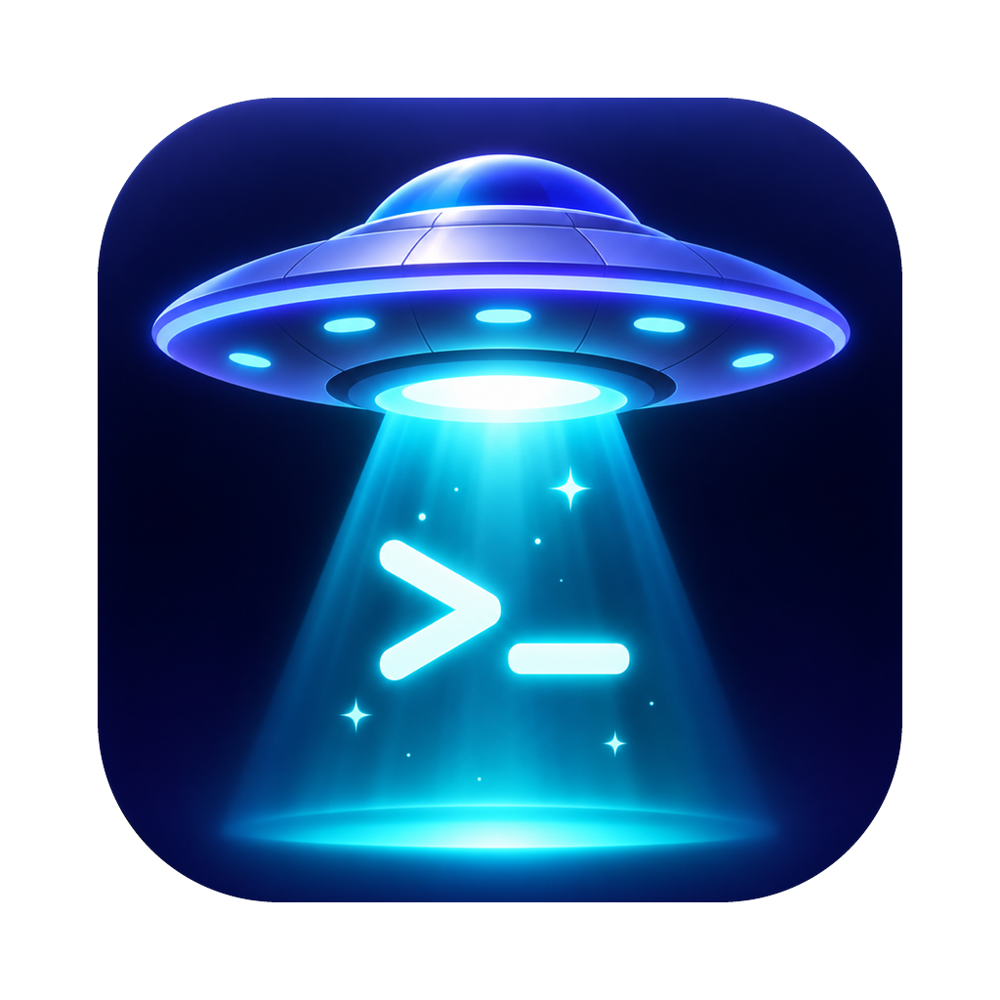

# Mothership



*Every session, every client, docked in one place.*

One dark Mac window for every [Claude Code](https://claude.com/claude-code) session across your
client projects. Made for video editors who run Claude in a folder per video, it works for any work
organised as clients and projects.

- **Clients and projects.** A project is any folder with a `script` folder inside (`mesa/Wren/2`,
  `mesa/Mara Stone/christmas special`, `Jules/2`); its client is the folder it sits in (Wren, Mara
  Stone, Jules), and a folder above that (an agency such as `mesa` or `Dawn Media`) shows dimmed
  beside the client's name. Every session of a project runs in its `script` folder.
- **The left panel** is one tree. Each client's name is a dropdown (**▸ WREN** `mesa` · 2 videos · 2 open):
  click it to unfold all its videos. A client starts folded unless a session runs in it, and the app
  remembers what you fold. Inside, each video. A numbered
  folder reads as **Video 2**; others keep their name (**busy parents**). Everything about a video is in
  one place under it: its open sessions (name, then state in colour: Ready, Working, or **Needs you**
  and why, e.g. "Claude needs your permission to use Bash"), its latest past sessions with **Resume**,
  and **+ New**. A video with sessions shows as a card with how many are open; one with nothing going on
  stays one line. **Find a client, video or session** at the top narrows the tree, also by a past
  session's name. The dock icon shows how many sessions need you.
- **Start a session**: **+ New session** (⌘N), find the project by client or project name (or pick a
  recent one), and Claude starts in its `script` folder, in a real terminal inside the app. **Use another
  folder…** covers anything that isn't a project.
- **Another session in the same video**: **+ New** on the video, or **+ New session in this video**
  (⌘T) on a session. The session header always says where you are (**WREN › VIDEO 2**) above the
  session's name. An untitled second session reads "New session 2" until Claude names it.
- **Names**: give one when you start it, or leave it empty and it is named automatically: Claude's own
  title for the conversation, or your first prompt until there is one. **Rename** any session: the ✎
  beside its name (open or past, in the tree or in History), the **Rename** button in the session
  header, or a double-click on the name. Your name always wins; clear it to go back to automatic. A
  `/rename` inside Claude is picked up too.
- **History** (⌘Y): every past conversation in your watched folders, newest first, by day, each under its
  client › project. Search names, titles, prompts and projects, filter by client, **Resume** one in its
  own folder (or **Show** it, when it is open).
- **Sessions keep running when you quit.** A small background host owns the sessions' terminals, so
  quitting the app (or closing its window) never stops Claude: open the app again and every session is
  where you left it, with its output. **File › Stop All Sessions and Quit…** (⌥⌘Q) stops them all;
  **Close** stops one. They do stop when the Mac restarts or you log out; then **Resume** them.
- **Choose folders** (bottom of the left panel): a checklist of every agency, client and video, right
  below the list. Tick what you want in the list, untick what you don't; it applies at once. Unticking
  an agency hides all its clients, a client all its videos. **Tick all** shows everything again. Kept as
  `hiddenFolders` in `config.json`. Something with a session running still shows, marked hidden.
- **A session in the client folder itself** (where a client's own files are, like `base`): **+ Session**
  on the client's heading. It is listed under the client as **Client folder**, above its videos, and
  its header reads **WREN › CLIENT FOLDER**. New session's picker offers each client's folder too.
- **Find**: the box at the top narrows the panel by client, video or session name.
- **Delete** a conversation: the bin beside a past session (hover it), **Delete** in History, or
  **Delete** in an open session's header. It asks first, stops Claude if it runs, and moves the
  conversation's transcript to the macOS **Trash** (put it back from there if you change your mind).
- **New client**: **+ New client** at the bottom. Type the client's name, pick an agency (the ones you
  have, like `mesa`; none; or a new one) and the first video (`1`). It makes
  `<watched folder>/<agency>/<client>/1/script`, shows the client in the panel as **CLIENT › Video 1**,
  and opens New session there. A name that is already a folder is refused; nothing is ever overwritten.
- **New video**: **+ Video** on a client's heading suggests the next number (`11` after `2` and `10`) and
  makes `<client>/<number>/script` (unfold the client to see **+ Video**). You can also make the folders yourself in Finder: any folder with a
  `script` folder inside shows up as a video when the window comes to the front.
- **Alerts**: a macOS notification when a session finishes its turn or asks for permission or input,
  unless you are looking at it. Click it to jump to that session. While the app is closed, the background
host still sends them (as plain macOS notifications).

## Install

You need a Mac with Apple silicon, [Node.js](https://nodejs.org) 22 or later, and
[Claude Code](https://claude.com/claude-code) installed and signed in (`claude` on your PATH).

```bash
git clone https://github.com/vaghmani-hash/mothership.git
cd mothership
npm install        # also unpacks Electron and builds the terminal (node-pty) for it
npm run package    # builds dist/mac-arm64/Mothership.app
```

Drag `dist/mac-arm64/Mothership.app` into Applications. The app is not signed: the first time,
right-click **Mothership.app** → **Open**. Allow notifications when macOS asks.

On first launch, **Choose your clients' folder…**: the folder your clients are in. Each client is a
folder in it (optionally inside an agency folder), and each video a folder in the client with a
`script` folder inside, where Claude runs:

```
Clients/                  ← the folder you choose
  Acme/                   ← a client
    1/                    ← a video ("Video 1")
      script/             ← Claude runs here
  Studio North/           ← an agency
    Northwind/            ← its client
      launch film/
        script/
```

**+ New client** and **+ Video** make these folders for you. To run it from source instead:
`npm run dev`.

**Watched folders…** (⌘,) at the bottom of the sidebar sets where your clients are and the folder
inside each project where sessions run (`script` by default; change it to whatever your projects use). Projects are
looked up again whenever the window comes to the front or you open New session, so a new project folder
shows up without a restart. Folders whose name starts with `.` or `_` and Premiere's own folders are skipped.

## Keys

| Key | |
|---|---|
| ⌘N | New session… |
| ⌘T | New session in the project of the session you are on |
| ⌘W | Close the session (asks while Claude is working) |
| ⌥⌘Q | Stop all sessions and quit |
| ⌘Y | History |
| ⌘, | Watched folders |
| ⇧↩ | New line in Claude's prompt |
| ⌘C / ⌘V | Copy the terminal selection / paste: text, a screenshot (attached as an image), or files copied in Finder (as their paths). Right-click has Copy and Paste too, and files dropped on a terminal paste as their paths. |
| ⌥⌘P | Pin the window on top of every other window (also the **Pin** button, top right) |
| ⌘+ / ⌘− / ⌘0 | Terminal text bigger / smaller / back to its usual size (every session; kept between launches) |

Closing the window or quitting keeps sessions running; **Stop All Sessions and Quit…** (⌥⌘Q) stops them.
Every conversation stays in History to resume.

## How it works

- Sessions run in a background host (`out/main/host.js`, run as Node on the app's Helper binary, detached, so macOS never takes it for the app),
  which the app reaches over `host.sock` in its folder and starts when it isn't running. It stops by
  itself a minute after the last session ends with no app open.
- Each session is your login shell running
  `claude --settings <app folder>/claude-settings.json --session-id <id>` in its folder, so Claude reads
  the folder's `CLAUDE.md` and your skills as usual, with your own PATH.
- **Your Claude Code settings are never changed.** The `--settings` file adds hooks (`SessionStart`,
  `UserPromptSubmit`, `Stop`, `Notification`, `SessionEnd`) only to the sessions this app starts; they
  run `hook.sh`, which drops each event into the app's `events/` folder. Sessions you start elsewhere
  don't have them; they show in History.
- **History** reads Claude Code's transcripts (`~/.claude/projects`, or `$CLAUDE_CONFIG_DIR/projects`)
  and never writes there. It reads only the start (folder, first prompt) and the end (latest title) of
  each file, so large transcripts stay fast. Print-mode runs (`claude -p`) are left out.
- The app's own files are in `~/Library/Application Support/Mothership/`: `config.json` (watched
  folders, the session folder, hidden folders, whether the window is pinned), `names.json` (your names, by conversation id), `hook.sh`, `claude-settings.json`, `events/`.
  Delete the folder to start fresh; your conversations stay in Claude Code's transcripts.

## Tests

```bash
npm run typecheck
npm test           # state rules, transcripts, names, the hook bridge, History, folders, real terminal sessions
npm run e2e        # drives the built app on scratch folders
```

The tests use `test/stub-claude.sh` in place of `claude` and scratch folders for everything: they never
read your client folders, Claude settings or transcripts.

## Layout

```
src/host/       the background host that keeps sessions running after the app quits
  server.ts       sessions, hook events, the socket, alerts while the app is closed, idle exit
  protocol.ts     the messages between the app and the host
src/main/       Electron main process
  index.ts        window, menu, IPC, notifications, dock badge
  host-client.ts  reaching the host (starting it when needed)
  create.ts       New client and New video folders
  sessions.ts     terminals (node-pty), session states, names, resume
  hooks.ts        hook.sh + claude-settings.json, and the events folder
  transcripts.ts  History: head and tail of each transcript
  projects.ts     finding the projects (folders with a script folder) under the watched folders
  store.ts        config.json and names.json
src/preload/    the window's bridge (window.api)
src/renderer/   the React window: left panel, session view, new-session dialog, History, settings
src/shared/     types and pure logic: states, transcript parsing, names, clients and projects, the API
test/           unit tests, the stand-in claude, and the e2e script
```

## License

[MIT](LICENSE)
